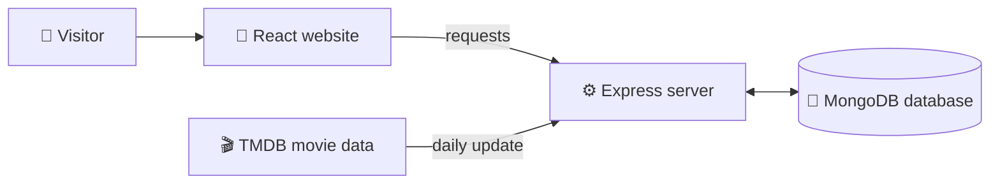

<div align="center">

# 🎭 Phantom Veil

### Your gateway to the world of horror movies

*Discover, explore and save the scariest films ever made, wrapped in a spooky, cinematic experience.*


### 🔗 [**Visit the live site →**](https://phantom-veil-omega.vercel.app)

</div>

---

## 👻 What is Phantom Veil?

Phantom Veil is a **horror movie hub**. It brings together around **1,000 horror films**, from timeless classics to upcoming releases, in one beautifully haunted place.

The moment you arrive, you're pulled into a stormy graveyard: rain falls, lightning flashes, bats fly past, fog rolls across the ground and eerie music plays. Your mouse cursor even works like a flashlight in the dark. 🔦

Behind the atmosphere is a full movie platform: browse, search, watch trailers, find where to stream a film, and keep your own watchlist.

## 🎬 Features

| | Feature | What it means for you |
|---|---|---|
| 🎞️ | **Huge horror library** | ~1,000 films, refreshed automatically every day |
| 🗂️ | **Smart rows** | Trending, Top Rated, Classics, Coming Soon, and more |
| 🧟 | **Sub-genres** | Supernatural, Psychological, Slasher, Zombie, Haunted House |
| 🔍 | **Search and browse** | Find films by title, actor, director, decade or rating |
| 🎥 | **Movie pages** | Trailer, cast with photos, director, rating and runtime |
| 📺 | **Where to watch** | See which streaming services have the film |
| ⭐ | **Watchlist** | Save films to watch later |
| 👤 | **Accounts and profile** | Sign up, log in, reset password, pick a favourite genre |
| 🛡️ | **Admin tools** | Manage movies and users |

## 🧩 How it works



1. The **website** (React) shows the spooky pages and movie rows.
2. It asks the **server** (Express) for data such as movies, search results or your watchlist.
3. The server reads and saves everything in a **MongoDB** database.
4. Every night, the server pulls fresh movie details from **TMDB**, a large public film database.

## 🛠️ Built with

- **Frontend:** React, TypeScript, Vite, Tailwind CSS, Framer Motion, shadcn/ui
- **Backend:** Node.js, Express, MongoDB with Mongoose
- **Security:** Secure passwords (bcrypt), login tokens (JWT), input checks (Zod), rate limiting
- **Quality:** 186 automated tests with Vitest
- **Hosting:** Vercel, with a daily scheduled sync

## 🚀 Run it yourself

```bash
npm install
cp .env.example .env     # add your MongoDB connection string
npm run dev              # website on :8080, server on :5000
```

Open **http://localhost:8080**. Demo login: `nightwatcher@phantomveil.app` / `Phantom123`

## 📚 More details

For the full API reference, security checklist, environment variables and deployment steps, see [`docs/TECHNICAL.md`](docs/TECHNICAL.md).

---

<div align="center">

*This product uses the TMDB API but is not endorsed or certified by TMDB.*

Made with 🩸 by **Ekansh Singh** · [GitHub](https://github.com/ekansh2010) · [LinkedIn](https://www.linkedin.com/in/ekansh-singh-005887289/)

</div>
